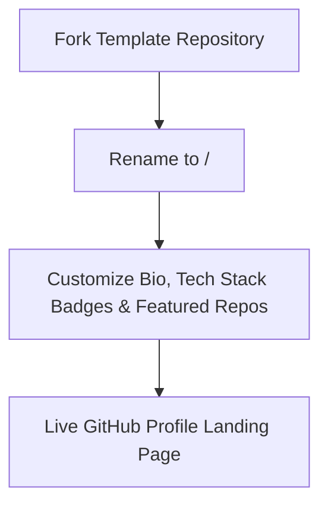

# Developer GitHub Profile README Template

> **Author & Architect:** [Robina Mirbahar](https://github.com/RobinaMirbahar) (Google Developer Expert in Cloud & AI)  
> **Focus:** Clean, Customizable Markdown & Badge Starter Template for Engineering Portfolios on GitHub

---

## 🎯 Why I Built Developer GitHub Profile README Template (Engineering Purpose & Real-World Value)

### 1. ✨ Helping Students & Developers Build Standout GitHub Profiles
During community workshops, students often ask how to structure their first GitHub profile README. I created this clean, fork-ready template so anyone can showcase their projects, skills, and social links with zero friction.

### 2. 🎨 Modular Badges & Responsive HTML/Markdown Layout
Uses standard GitHub-flavored Markdown and `shields.io` badges that render cleanly in both light and dark modes.

### 3. 🚀 Fork-and-Customize in 5 Minutes
Every section is clearly structured for rapid customization.

---

## 🏗️ System Architecture

---

 
   <h2 align="center">Hi there , Robina here  </h2>

   

   

   &nbsp;&nbsp;
    &nbsp;&nbsp;

      

## 🚀 About Me
I'm Robina from Pakistan, I'm a Freelancer , Cloud Architect, AWS Techical Trainer and Microsoft Certified Trainer. I really enjoy learning Cloud Technologies .I worked on Wordpress too on [Upwork](https://www.upwork.com). 

## 🧠 I'm currently learning..
-   Cloud Native and Kubernetes.

### - Currently Working on..
- 🔭 Working on [SheCloud](https://github.com/SheCloud). 

## Other Common Github Profile Sections you use in your Profile !
👩‍💻 I'm currently working on...

🧠 I'm currently learning...

👯‍♀️ I'm looking to collaborate on...

🤔 I'm looking for help with...

💬 Ask me about...

📫 How to reach me...

😄 Pronouns...

⚡️ Fun fact...

## - Skills and Experience
- Amazon Cloud &nbsp;&nbsp; Google  &nbsp;&nbsp; Microsoft Azure 

 
## - Your working Stats
Author - [@katherinepeterson](https://www.github.com/octokatherine)

 
   

    

   

    

## - Languages and Tools I used ⚙️ ...
<!-- For more icons please follow  https://github.com/MikeCodesDotNET/ColoredBadges -->
Author- [@MikeCodesDotNET](https://www.github.com/MikeCodesDotNET)

     
   
   
   
   
   
     
  
  
   
   

 

## - 💬 Get in touch...

 
 
 

<!-- AUTHOR_SIGNATURE_START -->
---

## 👩‍💻 About the Author

**Robina Mirbahar — Google Cloud & AI Architect**  
*Google Developer Expert (GDE) in Cloud & AI • Published Author • Multi-Agent Systems & Serverless GPU Builder*

<!-- AUTHOR_SIGNATURE_END -->
